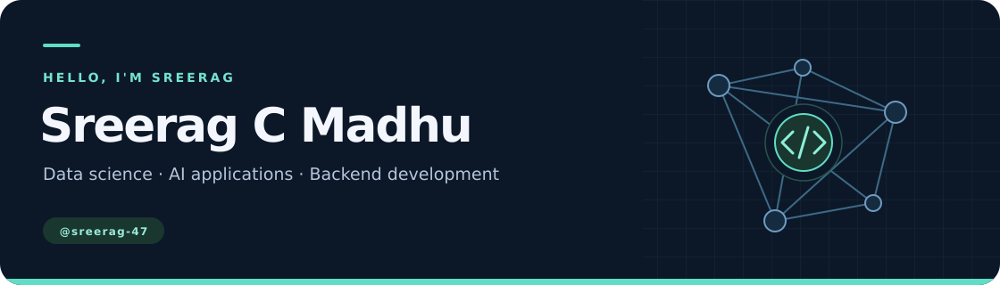

  

  <b>B.Tech Data Science student at MACE</b> 
  Exploring data, building useful applications, and learning through projects.

  <a href="https://www.linkedin.com/in/sreergcmadhu">LinkedIn</a> &nbsp; · &nbsp;
  <a href="https://github.com/sreerag-47?tab=repositories">Explore my repositories</a>

## Selected projects

<table>
  <tr>
    <td width="50%" valign="top">
      <h3>📍 Civic Pulse</h3>
      
A hackathon demo that groups citizen grievances by category and location, with voice input and an interactive map.

      
<b>Python · FastAPI · Tailwind CSS</b>

      <a href="https://github.com/sreerag-47/Codexhackathon">Explore the project →</a>
    </td>
    <td width="50%" valign="top">
      <h3>🛡️ BankGuard</h3>
      
A rule-based fraud-detection backend with transaction risk scoring, JWT authentication and explainable audit trails.

      
<b>Python · FastAPI · PostgreSQL</b>

      <a href="https://github.com/sreerag-47/fraud-detection">Explore the project →</a>
    </td>
  </tr>
  <tr>
    <td width="50%" valign="top">
      <h3>🎙️ JobSathi</h3>
      
A multilingual, voice-driven resume builder with translation, PDF generation and job-search integrations.

      
<b>React · Python · FastAPI</b>

      <a href="https://github.com/sreerag-47/JOB_SATHI">Explore the project →</a>
    </td>
    <td width="50%" valign="top">
      <h3>📊 Expense Tracker</h3>
      
A team project for tracking income and expenses, visualizing spending and exploring AI-assisted insights.

      
<b>JavaScript · Express · MongoDB</b>

      <a href="https://github.com/sreerag-47/expense-tracker">Explore the project →</a>
    </td>
  </tr>
</table>

## Technologies in these projects

| Area | Tools |
| --- | --- |
| Languages | Python, JavaScript, SQL |
| Backend | FastAPI, Node.js, Express, SQLAlchemy |
| Frontend | React, HTML, CSS, Tailwind CSS |
| Data & storage | PostgreSQL, MongoDB, Chart.js |
| Development | Git, GitHub, Docker |

## More to explore

- [FLAMES](https://github.com/sreerag-47/FLAMES): a web calculator with zodiac-sign matching.
- [Trend Surfing](https://github.com/sreerag-47/trend-surfing-flight-delay): a fork of [soorajjmanuu/trend-surfing-flight-delay](https://github.com/soorajjmanuu/trend-surfing-flight-delay), exploring unusual trends in multidimensional datasets.

<b>Let's build something cool.</b>

